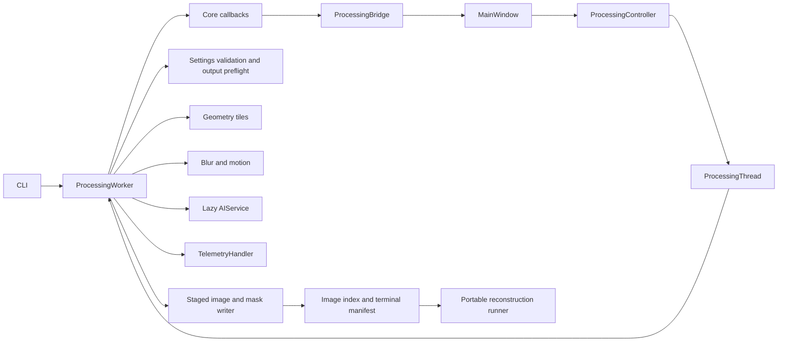

# Application architecture

This document describes the current Studio development sources. See [October validation](docs/implementation-2026-10-23/VALIDATION.md) for evidence and remaining qualification work.

## Execution and ownership

`core/processor.py` is Qt-free. The CLI calls `run()` synchronously; Studio owns a `ProcessingController`, which owns a `ProcessingThread` and the worker. `ProcessingBridge` forwards callbacks through Qt signals. Completion of the GUI controller means the thread has terminated, not merely that an image task was submitted.

`stop()` requests cooperative cancellation. CLI SIGINT requests a stop without interrupting publication of confirmed records; it returns 130 after draining writes and finalizing the manifest. Every submitted write is collected before a terminal manifest. Projection tiles and metadata subprocesses observe cancellation. The GUI defers closing until active extraction, analysis and preview work ends. Video decoder and model calls may still impose cancellation latency.

Thumbnail work uses a shared pool capped at four jobs and returns QImage. Preview has its own single-worker pool, cancels superseded requests and invalidates stale generations. It releases its AI cache on disable/removal/close and is suspended and drained before extraction starts. GUI-only QPixmap creation stays in the GUI thread. Blur analysis owns a QThread and records job identity, settings snapshot and revision; edited jobs reject stale results.

## Settings and output contract

`validation.py` merges defaults and checks types, ranges, enums, active views, AI targets, model trust and a projection memory budget. `output_plan.py` discovers and deduplicates input files, excludes prior datasets and validates output names. Every run gets a new `_processed`, `_processed_001`, … folder. Replacing or resuming an existing run is deliberately not yet implemented.

`mask_profiles.py` owns destination mask polarity and filename conventions. Named profiles normalize settings before preview or processing; custom preserves manual settings. The manifest's `mask_contract` records ignored/kept pixel values, meaning and smoothing. Postshot Remove Occluders and COLMAP have opposite conventions and cannot share an inverted mask export.

`storage.py` supplies Studio estimates and the worker's rolling disk guard. The first check resolves the nearest existing destination ancestor and precedes model loading/output creation; later checks run before submitting a capture's writes. The budget covers all active views and possible masks plus encoder overhead and a 256 MiB reserve. Compression ranges and nominal-FPS counts are planning estimates before filtering; model caches and reconstruction workspaces are excluded. Low space mid-run produces a failed manifest with previously confirmed outputs, not an automatic resume point.

`FileManager.write_pair` stages complete image/mask files before publishing them. Failed writes raise, all futures are inspected, and counters count confirmed writes. `images.jsonl` lists successful images with camera/frame associations. Manifest schema 2 starts in running state and records terminal state, output folder, counts, errors and run identity. It distinguishes source size/mtime identification from cryptographic verification; a source hash is not yet calculated. Publishing two files is not a power-loss-atomic transaction; a process kill can leave partial files/index data and a running manifest.

## Image and model pipeline

Geometry uses float64 ray tiles and float32 remapping tables. Preview, analysis and export share generated views and fixed-point OpenCV maps. Longitude wraps periodically; four replicated rows at each latitude edge isolate the poles for linear and Lanczos sampling. The padded source is prepared once per decoded frame. Preview scores are calculated at export resolution before sharpening or overlays, then its display image is reduced. Flat input retains its aspect ratio and is exported at native resolution.

AI loading is lazy; loading/inference failures propagate. Batches contain at most two inputs. Standard model weights use a stable user cache. Custom `.pt` loading requires explicit trust at the settings/CLI boundary. Returned masks are requested at original image dimensions; feather is smoothing of a binary mask, not a native model probability.

## Telemetry and reconstruction

FFprobe packet data preserves CAMM/GPMF packet PTS. GPMF samples are distributed inside each packet's declared duration. CAMM supports standard GPS types 5 and 6. GPMF GPS9 records are explicitly unsupported pending fixtures. GPX 1.0/1.1 and SRT sidecars are recognized case-insensitively. Sidecar alignment still assumes their start corresponds to video start. Lookup is bounded to available times and a maximum interpolation gap.

Direction of travel is not written as optical heading. Filesystem mtime is not used as capture time; optional container creation_time is read independently of GPS export and sidecars. Sidecar selection is deterministic (valid GPX before SRT). Missing and relative altitude remain identified and omitted from orthometric EXIF. `FrameClock` validates decoded timestamps and records any FPS fallback, including on frames not selected for export. A known exact frame count deficit fails; an estimated container count mismatch is reported as a warning.

COLMAP export includes an image index, separate mask tree, per-camera image folders and a rig configuration relative to an active reference camera. Before staging, the portable runner validates the complete index, rig and COLMAP availability. Sources remain inside the dataset; destinations must be unique and fallback copies are exclusive. It applies `rig_configurator` before sequential matching. Real reconstruction, supplier camera compatibility and non-central stitching effects remain to be qualified.

## Validation and packaging

CI runs core tests on three operating systems and Qt tests in dedicated jobs. A subprocess test covers GUI extraction, relaunch, failure, cancellation and normal exit. Whole-project typing is blocking, with additional checks inside untyped function bodies for the four critical controller/validation/output modules.

The wheel explicitly includes QSS. CI exercises it from site-packages outside the checkout. Release builds depend on CI, scan installed Python dependencies and refuse to overwrite an already published release. Windows builds include separate GUI and console executables sharing one dependency bundle. A hashed macOS arm64/Python 3.13 lock is qualified locally. Windows/CUDA locks, signed binaries, GPU qualification and clean-machine testing remain release prerequisites.
